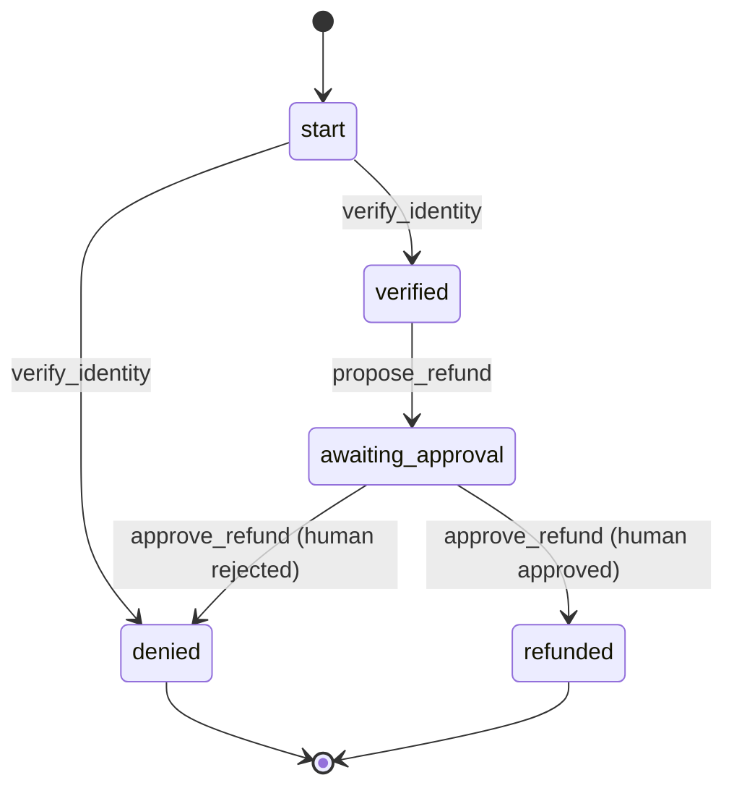

# concordat

**Typed sessions for AI agents.** Agents are objects whose interfaces are protocols,
and the runtime enforces those protocols on the model.

> Status: pre-alpha. Agent classes, the protocol/session/budget kernel, and runners for
> Claude (Anthropic) and OpenAI work. See [docs/design.md](https://github.com/miladsikaroudi/concordat/blob/main/docs/design.md).

## Why

"Never refund before verifying identity" usually lives in a prompt and is hoped for.
Concordat makes it a checked protocol:

- **Protocol fidelity:** the session follows the declared order of turns.
- **Least privilege per step:** the model only gets the tools legal in the current state.
- **Bounded spend:** tokens, tool calls and dollars stay within budget, even across handoffs.

## Evidence

On [τ-bench](https://github.com/sierra-research/tau2-bench)'s 50 airline tasks, with
simulated customers who push the agent to skip confirmation (Claude Haiku 5.5 as the
agent, three runs, 128 task-runs both agents completed):

| | Tasks passed | Changes made without the customer's "yes" |
|---|---|---|
| standard agent | 112 / 128 | 50 (in 29 task-runs) |
| concordat agent | 105 / 128 | **0** |

The standard agent broke the airline's confirmation rule in every run; concordat never
did. The price today: when a customer kept refusing to say yes, the concordat agent
sometimes transferred them to a human instead of asking again, which costs some task
success. With cooperative customers neither agent broke the rule. Setup, limits and
all runs: [bench/RESULTS.md](https://github.com/miladsikaroudi/concordat/blob/main/bench/RESULTS.md).

## Example

```python
from concordat import Agent, Budget, human, tool

class RefundAgent(Agent):
    final = {"refunded", "denied"}
    budget = Budget(tool_calls=10)

    @tool(when="start", then={True: "verified", False: "denied"})
    def verify_identity(self, user_id: str) -> bool:
        return lookup(user_id).verified

    @tool(when="verified", then="awaiting_approval")
    def propose_refund(self, amount: float) -> float:
        return amount

    @human(when="awaiting_approval", approve="refunded", reject="denied")
    def approve_refund(self, amount: float) -> str:
        return f"Refund ${amount}?"         # shown to the human approver

agent = RefundAgent()          # protocol already checked when the class was defined
agent.allowed_tools()          # {'verify_identity': ...}: all the model gets to see
agent.propose_refund(5000)     # ProtocolViolation, raised before the body runs
```

### See the process

`RefundAgent.diagram()` draws the protocol, straight from the class:



### Safe inheritance

Specialise an agent by subclassing it. Adding steps is fine; bypassing the parent's
is rejected when the class is defined:

```python
class FastRefundAgent(RefundAgent):
    @tool(when="start", then="refunded")
    def instant_refund(self, order_id: str) -> str: ...

# ProtocolError: FastRefundAgent breaks RefundAgent's protocol: after instant_refund,
# it reaches 'refunded', which RefundAgent only reaches through
# verify_identity → propose_refund → approve_refund
```

So a team can define a compliant base agent once, and every specialised version
keeps its safety steps.

### Running it with Claude

```bash
pip install "concordat[anthropic]"
```

```python
import anthropic
from concordat.anthropic import run

result = run(RefundAgent(), anthropic.Anthropic(), "Please refund order A-100.")
result.status   # "done", or "waiting" if Claude asked the user something
```

Each turn Claude is offered only the actions legal in the current state (a human
step appears as a request that only the approver can decide), one call per
response. Every response's tokens are charged to the agent's budget, and the next
response is capped to what is left. Illegal or invalid calls go back to Claude as
errors so it can correct itself. See [examples/refund.py](https://github.com/miladsikaroudi/concordat/blob/main/examples/refund.py).

### Running it with OpenAI

The same loop over the Responses API (`pip install "concordat[openai]"`):

```python
import openai
from concordat.openai import run

result = run(RefundAgent(), openai.OpenAI(), "Please refund order A-100.", model="...")
```

### Without classes

The same protocol, using the kernel directly:

```python
from concordat import Budget, Protocol, Session

refund = Protocol(
    "start",
    {
        "start": {"verify_identity": {"verified", "denied"}},
        "verified": {"propose_refund": {"awaiting_approval"}},
        "awaiting_approval": {"human.approve": {"refunded"}, "human.reject": {"denied"}},
    },
    final={"refunded", "denied"},
)  # checked here: no dead ends, no unreachable states

session = Session(refund, Budget(tokens=50_000, tool_calls=10))
session.allowed_actions()           # {'verify_identity'}: only these tools go to the model
session.step("propose_refund")      # ProtocolViolation: not allowed in state 'start'
```

Handing work to another agent splits the budget, and the parent can't spend it twice:

```python
child_budget = session.budget.split(tokens=10_000, tool_calls=3)
```

## Development

```bash
uv sync
uv run pytest
uv run mypy src
uv run ruff check
```

## License

Apache-2.0
